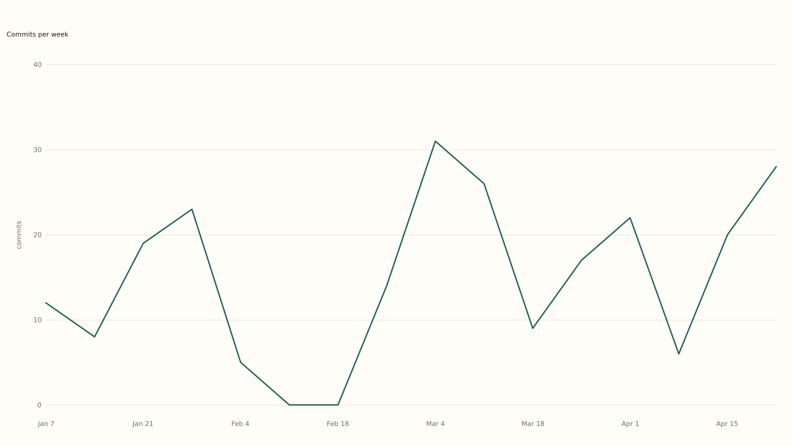
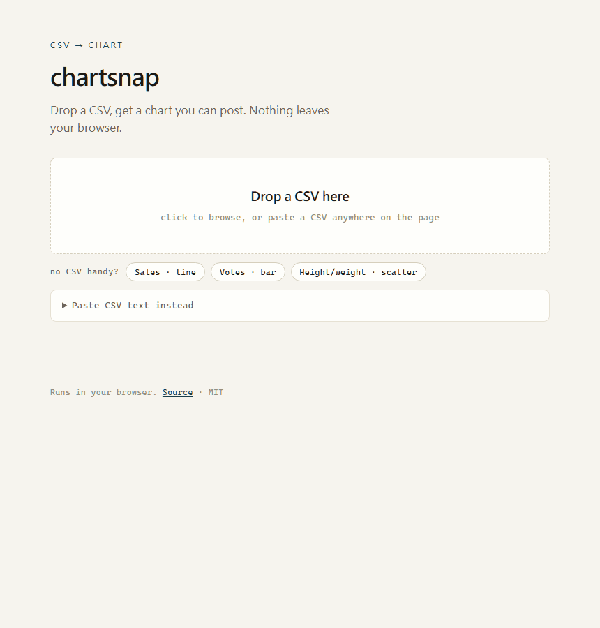
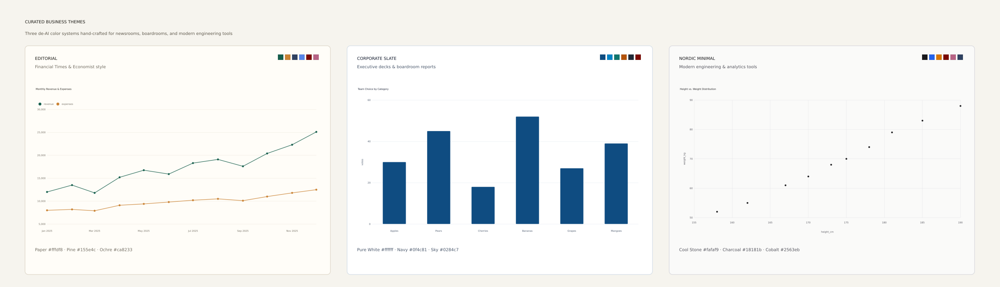

# chartsnap

Turn a CSV into a chart you can post, without uploading it anywhere.

Drop a file, chartsnap guesses a chart from your columns, and you download a PNG or SVG
sized for slides, social media, or an A4 page — or copy the PNG straight to your clipboard.
It all runs in the browser, so your data never touches a server.

**Live:** https://kbwen.github.io/chartsnap/



## Why it exists

You've got a small spreadsheet and want one good-looking chart for a post or a doc.
The usual options are all a bit annoying: Excel looks like Excel, Datawrapper and
Flourish want a login and put SVG behind a paywall, RAWGraphs makes you map every axis
by hand, and pasting company numbers into a chatbot means they've left your laptop.

chartsnap keeps it local and boring: drop, chart, download. Nothing uploads, it works
offline once loaded, and the same CSV gives you the same chart every time on your machine.
SVG export is free.

## Try it

Open the [live version](https://kbwen.github.io/chartsnap/), or run it locally:

```bash
npm install
npm run dev
```

No CSV to hand? There are sample buttons on the page.



## How it picks a chart

It looks at what's in each column:

| Your data                          | Chart        |
| ---------------------------------- | ------------ |
| a date or quarter column           | line         |
| 4-digit years under a `year` header | line, by year |
| text categories + numbers          | bar (horizontal if labels are long or numerous) |
| two or more number columns         | scatter (or line with continuous numeric X-axis) |
| a single number column             | bar, by row  |

Extra number columns become extra series, up to six — if any don't fit, the chart says
which. When category labels are long or numerous, chartsnap automatically renders horizontal
bars so category names stay readable and are never drawn anonymously without labels.
Guessed wrong? There's a line / bar / scatter switch under the chart. If you switch a
two-number scatter plot to `line`, it keeps a continuous numeric X-axis with proportional
spacing rather than flattening values onto arbitrary discrete categories.

### Curated business themes

Visual themes give your chart the right tone for where it's being shared — designed without synthetic gradients, glowing neons, or AI design clichés:



- **Editorial** (default) — warm paper background (`#fffdf8`) with deep pine lead (`#155e4c`) and warm ochre accents. Quiet authority and thoughtful editorial reporting, inspired by *The Financial Times* and *The Economist*.
- **Corporate Slate** — crisp pure white (`#ffffff`) with classic navy lead (`#0f4c81`) and balanced slate tones. Confident, clean presentation tailored for boardrooms, investor memos, and executive decks.
- **Nordic Minimal** — cool stone background (`#fafaf9`) with pitch charcoal lead (`#18181b`) and graphite rules. Restrained modern precision, tuned to match tools like Linear and contemporary technical analytics.

Every theme palette is mathematically verified:
- **WCAG 1.4.11 graphical contrast** $\ge 3:1$ against its canvas background across rounding boundaries.
- **Color vision deficiency (CVD) safety**: Machado 2009 simulation guarantees pairwise $\Delta E00 \ge 15.0$ for protanopia and deuteranopia, and $\Delta E00 \ge 9.0$ for tritanopia (~4× JND).

### Export presets

Pick a size and download, or copy straight to your clipboard in one click. PNG and SVG both, free, no watermark, saved with descriptive slugified filenames based on your chart title or source file. SVG exports declare responsive `viewBox` coordinates for lossless scaling in Figma, Keynote, Illustrator, and responsive web layouts.

- **Slide 16:9** — 1920 × 1080 (presentations, Keynote, PowerPoint, Google Slides)
- **Twitter card** — 1200 × 675
- **Instagram post** — 1080 × 1080
- **Instagram story** — 1080 × 1920
- **A4 print** — 3508 × 2480 (300 DPI, landscape)

- **1-click Copy PNG**: copies the rendered chart directly to your clipboard for instant pasting into Slack, Notion, docs, or slide decks without file-picker detours.

## What it handles

Messy real-world spreadsheet exports:
- **Currencies, percentages, and accounting numbers**: `$`, `€`, `£`, `¥`, `NT$`, `HK$`, `S$`, `₩`, `₹`, and `%` are stripped cleanly so numbers parse as numbers, while units are preserved on the series label. Accounting negatives in parentheses like `(500)` parse as negative numbers (`-500`).
- **CJK magnitude normalization**: columns mixing `億元`, `萬元`, `千元`, or `元` (and bare `億`/`萬`/`千`) are scaled to the column's dominant unit, so mixed magnitudes chart on an honest shared scale without 10,000× distortion.
- **Excel title rows & summary footers**: a single-cell title row across row 1 is extracted as the chart's title rather than choking column detection. Trailing summary rows (`Total`, `合計`, `Grand Total`, `Average`) are excluded so totals never double-count the series or dwarf the data.
- **Numbers**: quoted commas, US and European numbers (`1,234.56` and `1.234,56`, decided per column).
- **Dates**: `2025-01-05`, `2025.01.05` (year-first dot dates), `2025-01`, `2025/01/05`, quarters (`2025-Q1`, `2025 Q1`, `Q1 2025`), `2025-01-01T09:30:00Z` (and with an offset), `2025-01-01 09:30`, `March 2025`, `5 January 2025`, `Jan 5, 2025`, and 4-digit years under a `year` header. Bare calendar dates mean the same day in every timezone.
- **Spreadsheet copies**: Excel and Google Sheets TSV pasted straight onto the page.
- **Blank cells & large files**: blank cells are drawn as gaps; files over 1,000 rows are sampled down with an explanatory note.
- **Encoding fallbacks**: Big5 or Latin-1 exports still chart, with an honest note explaining why labels came out as `�` and to re-save as UTF-8. It won't refuse your file: it can't reliably tell a whole mis-encoded export from two stray bytes in a good one, so it says what it saw and lets you decide.

Dates chartsnap does not read: anything ambiguous — `01/02/2025`, `Jan-25`, `114/01/05` — is treated as text rather than guessed at, because the guesses were silently wrong (`Jan-25` used to chart as 25 January **2001**).

It works offline once you've loaded it — a service worker keeps the page and its assets on your machine. A dead connection falls back to that copy; a connection that hangs rather than failing, or a captive portal that answers with its own login page, can still stall the load.

On the same machine and browser, the same CSV produces the same chart, down to identical bytes in the exported PNG and SVG. Across machines it won't: `system-ui` resolves to a different font per OS, and the label positions are measured from it. If a numeric column doesn't fit on the chart, it says which.

Accessible by design: the dropzone is a keyboard-interactive button, chart titles exist in the DOM as real headings, charts include an accessible summary and synchronized data table for screen readers, and notes/status are permanent live regions.

## What it isn't

- Not a chart builder. No manual axis/field mapping UI — if you need to wire things up by hand, [RAWGraphs](https://github.com/rawgraphs/rawgraphs-app) does that well.
- No dashboards, accounts, or saved state.
- Editable titles and labels aren't in yet.
- A lone `3.850` is genuinely ambiguous — 3.85, or 3850 with a European thousands dot? It's read as 3.85 and the chart tells you so. Nothing in the column can settle it.
- It charts rows as they are — it doesn't sum or group-by aggregate raw rows.
- Multi-series charts are tuned for color and color vision deficiency (CVD: protanopia/deuteranopia safe), not black-and-white print: distinguishing six series in pure grayscale on social presets would require high-contrast monochrome patterns or harsh lightness steps that break the muted palette.

## Under the hood

Vite and vanilla TypeScript, [Chart.js](https://www.chartjs.org/) for drawing, [PapaParse](https://www.papaparse.com/) for the CSV, and [canvas2svg](https://github.com/gliffy/canvas2svg) for the vector export. No backend; it ships as static files to GitHub Pages. Zero analytics, zero cookies, zero third-party scripts.

`npm test` runs 562 tests across 25 suites, covering column auto-detection, horizontal bar label preservation, continuous numeric X-axes, time-axis synchronization, CJK magnitude scaling, responsive SVG serialization, CVD & WCAG contrast tripwires, negative controls, zero-trust prototype pollution defense, UTF-8 BOM sanitization, keyboard velocity, and multi-target PNG exports.

## License

MIT © [KbWen](https://github.com/KbWen)
